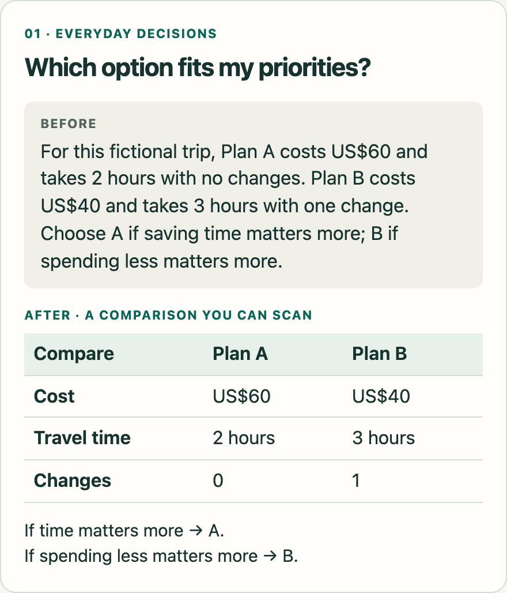
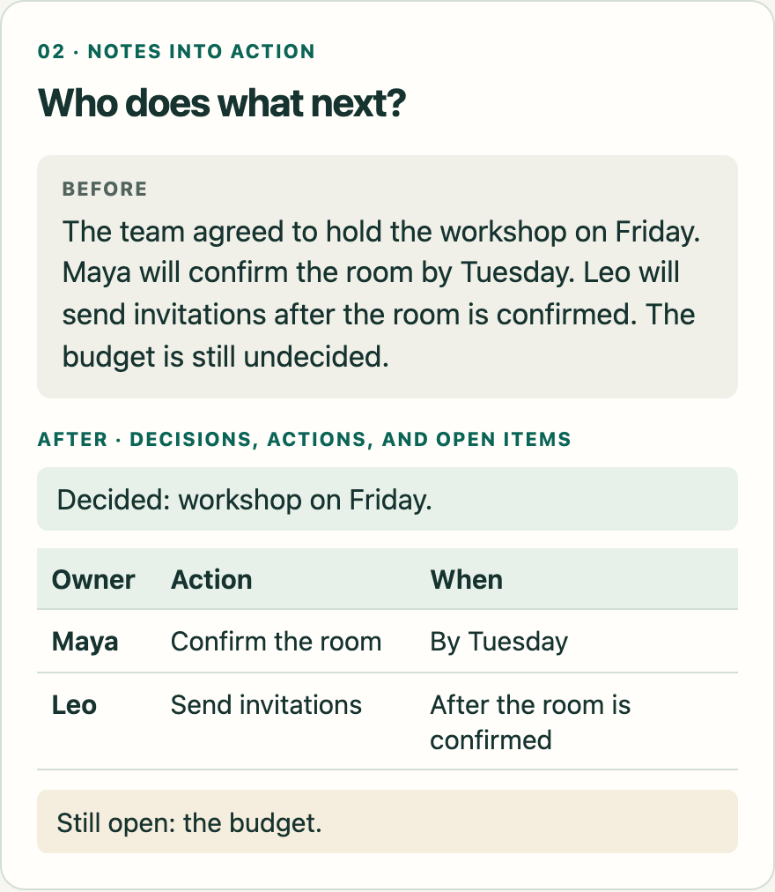
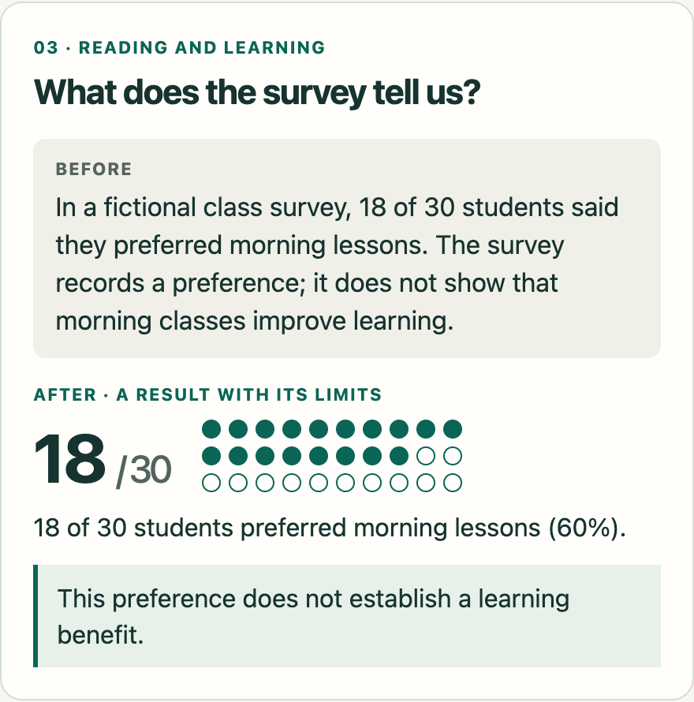
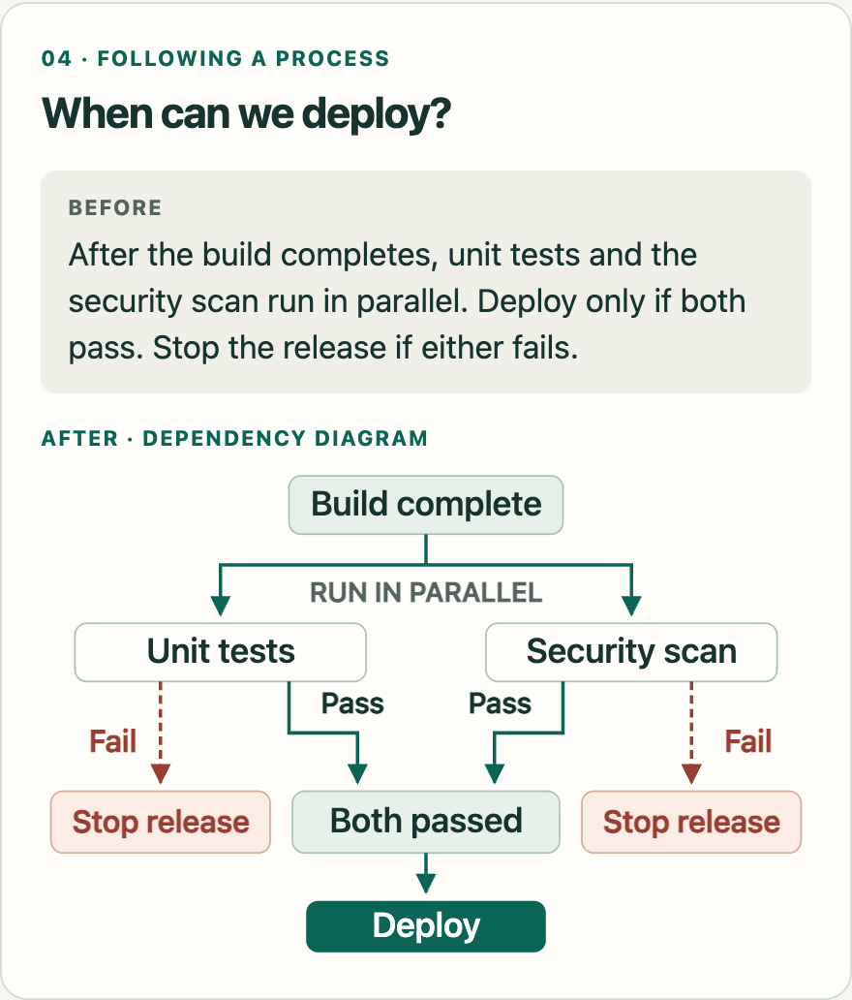
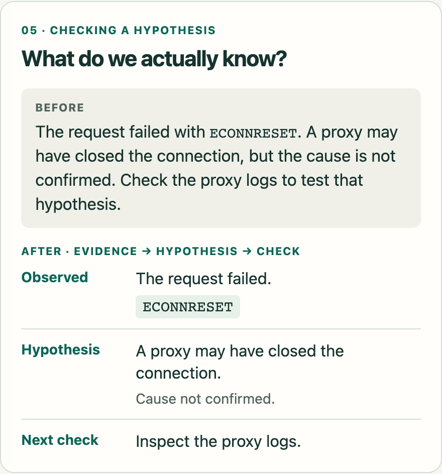
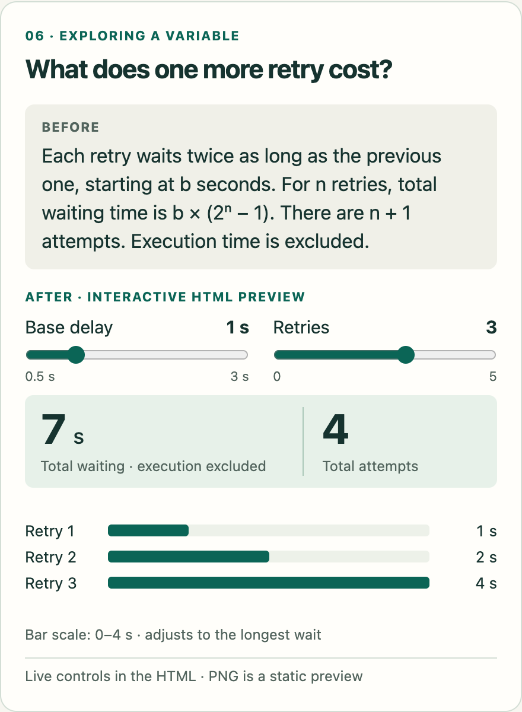

# Clear Output

[简体中文](README.zh-CN.md)

[Live demo](https://jiansen.github.io/clear-output-skill/) · [Install](#install-and-use) · [Latest release](https://github.com/Jiansen/clear-output-skill/releases/latest) · [What's changed](CHANGELOG.md) · [Get update notifications](references/updates.md)

One skill for clearer AI output in Chinese, English, and mixed-language tasks. It uses words, diagrams, and interaction to help the reader understand and verify the result while preserving language, factual meaning, uncertainty, and technical literals.

**Who's it for?** People using AI agents to compare choices, learn something, turn notes into action, explain a process, or check a result—in everyday life, study, teamwork, and technical work.

## Before / after

Six examples of making the same information easier to inspect. Choose the form that helps the reader; these are starting points, not a limit on the skill's uses.

<p align="center">
  <a href="assets/readme/choices-en.png"></a>
  <a href="assets/readme/meeting-en.png"></a>
</p>

<p align="center">
  <a href="assets/readme/reading-en.png"></a>
  <a href="assets/readme/release-en.png"></a>
</p>

<p align="center">
  <a href="assets/readme/debugging-en.png"></a>
  <a href="assets/readme/retry-en.png"></a>
</p>

These are editorial examples of presentation, not measured model A/B results. The travel, workshop, and survey scenarios are fictional. The linked animation uses actual working HTML states; playback speed does not represent retry duration.

Click a card for the full-size image. Try the [live bilingual demo](https://jiansen.github.io/clear-output-skill/) in your browser, or download/open the [offline gallery](assets/readme/examples.html); GitHub's source view does not run HTML. [Animated retry preview](assets/readme/retry-en.gif) · [Static retry preview](assets/readme/retry-en.png) · [All six examples and sources](assets/readme/README.md) · [Social images and post drafts](assets/showcase/README.md) · [Actual evaluation](evals/pilot-report.md).

## What it does

- Chooses language from the user's request and the artifact being edited. An English debugging conversation stays English. A Chinese question about an English log gets a Chinese explanation with the log intact.
- Preserves facts, conditions, exceptions, approximate values, permissions, and recommendations. `May` does not become `will`; `约 5 秒` does not become an exact delay.
- Separates observed behavior from hypotheses and verified outcomes.
- Chooses the representation before polishing the wording: a table for shared criteria, a diagram for branches and dependencies, a chart for measured patterns, interaction for exploring variables, or animation/video for a mechanism that develops over time.
- Proactively creates a useful visual within the task's scope, checks the rendered result when possible, and distinguishes source/storyboards from working artifacts. A short factual answer can stay one sentence.

The skill applies to the current task. It does not turn the whole conversation into a permanent language or style mode. It does not check whether source facts are true, and it does not certify ASD-STE100 compliance.

## Install and use

With the optional [skills CLI](https://github.com/vercel-labs/skills), run this in your project:

```bash
npx skills add Jiansen/clear-output-skill --skill clear-output
```

Requires Node.js 22.20+. Select your agent when prompted; add `-g` for a personal installation. Already installed? Use your existing copy. The CLI has its own [installation telemetry](https://skills.sh/docs/cli); set `DISABLE_TELEMETRY=1` to opt out. Manual installation and release ZIPs are available below. The CLI installation was checked in isolated Codex, Claude Code, and Cursor project locations; this does not establish model-output quality in those hosts.

The core instructions work without a runtime or background service. Optional local checks use Python 3.10+ with no extra packages. Producing visual artifacts uses whatever rendering tools the host provides; the skill does not depend on a specific plugin.

The same `SKILL.md` and `references/` work in **Codex, Claude Code, and Cursor**. The optional `agents/openai.yaml` supplies Codex display metadata; the instructions require no host-specific tools. The terminal examples below use Bash on macOS/Linux and require Git.

| Host | Personal installation directory | Project-only directory | Invoke |
| --- | --- | --- | --- |
| Codex | `~/.agents/skills/clear-output/` | `.agents/skills/clear-output/` | `$clear-output` |
| Claude Code | `~/.claude/skills/clear-output/` | `.claude/skills/clear-output/` | `/clear-output` |
| Cursor | `~/.cursor/skills/clear-output/` | `.cursor/skills/clear-output/` | Type `/` in Agent chat and select `clear-output` |

Choose the section for your host. If it already lists `clear-output`, use that installation instead of adding another copy.

<details>
<summary>Codex</summary>

Ask the built-in installer:

```text
$skill-installer install https://github.com/Jiansen/clear-output-skill
```

Or install manually:

```bash
mkdir -p ~/.agents/skills
git clone https://github.com/Jiansen/clear-output-skill.git ~/.agents/skills/clear-output
```

Host versions can use different skill directories; the built-in installer follows its host's configuration. See [Codex skill documentation](https://developers.openai.com/codex/skills).

</details>

<details>
<summary>Claude Code</summary>

Install for your local Claude Code sessions:

```bash
mkdir -p ~/.claude/skills
git clone https://github.com/Jiansen/clear-output-skill.git ~/.claude/skills/clear-output
```

Then invoke `/clear-output` in Claude Code. If it is missing, run `/reload-skills` or start a new session. See [Claude Code skills](https://code.claude.com/docs/en/skills).

</details>

<details>
<summary>Cursor</summary>

Install for your local Cursor Agent:

```bash
mkdir -p ~/.cursor/skills
git clone https://github.com/Jiansen/clear-output-skill.git ~/.cursor/skills/clear-output
```

Open a new Agent chat, type `/`, and select `clear-output`; restart Cursor if the new skill is not discovered. Cursor also reads `.agents/skills/`, `.claude/skills/`, and `.codex/skills/` and their user-level equivalents, so an existing Codex or Claude Code installation may already appear. Its **From GitHub Repository** UI installs marketplace plugins; this repository provides a standalone skill, so use the directory installation above. See [Cursor skills](https://cursor.com/docs/skills).

</details>

<details>
<summary>Project-only and Windows installations</summary>

For one repository, extract the [release ZIP](https://github.com/Jiansen/clear-output-skill/releases/latest/download/clear-output.zip) into the project-only directory in the table. Keep the folder name `clear-output` and the complete package, including `references/`, `scripts/`, and `VERSION`. Commit those files if teammates should receive the skill. Codex's `agents/openai.yaml` is optional display metadata.

In Windows PowerShell, for example:

```powershell
New-Item -ItemType Directory -Force "$HOME/.claude/skills" | Out-Null
git clone https://github.com/Jiansen/clear-output-skill.git "$HOME/.claude/skills/clear-output"
```

Replace `.claude` with `.cursor` for Cursor or `.agents` for Codex. Install in the environment where the agent runs; a local installation is not automatically a remote/cloud installation. For Cursor Cloud Agents, use the documented [personal-skill sync](https://cursor.com/help/customization/skills) or project skills.

</details>

<details>
<summary>Claude on the web, Desktop chat, or Cowork</summary>

Use Claude's account-level skill upload. Local Claude Code folders do not by themselves install a skill into these surfaces.

Download the ready-to-upload [release ZIP](https://github.com/Jiansen/clear-output-skill/releases/latest/download/clear-output.zip), or build one from a checkout:

```bash
python3 tools/build_release.py --output-dir dist
```

The build writes `dist/clear-output.zip` and `dist/SHA256SUMS`. The ZIP contains one `clear-output/` directory with instructions, references, optional scripts, version metadata, changelog, and license. In Claude, enable code execution/file creation if needed, then open **Customize → Skills → + → Create skill → Upload a skill**, upload the ZIP, and enable it. Ask Claude to use `clear-output` for your task. See [Claude's upload instructions](https://support.claude.com/en/articles/12512180-use-skills-in-claude) and [ZIP structure](https://support.claude.com/en/articles/12512198-how-to-create-custom-skills).

</details>

### Verify and update

Check that the installed `clear-output` folder contains `SKILL.md`, `VERSION`, and the complete `references/` and `scripts/` directories. Try this in Claude Code or Cursor:

```text
/clear-output Explain this failing test in English. Keep the error text unchanged: expected 2 calls, received 3.
```

For Codex, use `$clear-output` instead of `/clear-output`. Chinese and mixed-language examples:

```text
$clear-output 帮我改清楚这段说明，保留原意、数值和不确定性。
```

```text
$clear-output 润色下面的英文 README，正文保持英文，用中文解释修改。
```

Use your host's invocation prefix in these examples. Expect English for the English debugging request and English README text with Chinese edit commentary for the mixed-language request. The description also permits automatic selection for matching tasks; triggering and available rendering tools depend on the host.

To hear about updates, select **Watch → Custom → Releases** on this repository. Each tagged release includes notes, a skill ZIP, and a checksum. From the installed skill directory:

```bash
python3 scripts/clear_output.py --version
python3 scripts/check_update.py
```

The update check explicitly requests public release metadata; it does not upload your text or change installed files. A local skill copy does not fetch GitHub updates by itself. For a Git clone tracking a branch, preserve local edits and use `git -C <installation-directory> pull --ff-only`; this follows the branch, which can contain unreleased changes. For copied/installer-downloaded or uploaded skills, update the complete release package. See [the upgrade guide](references/updates.md) for pinned tags, backups, and host reload behavior, and [the changelog](CHANGELOG.md) for changes.

Installation paths and invocation methods were checked against the linked official documentation on 2026-11-08. We verified the directory layouts and ZIP contents; automatic activation and output quality have not been tested in live Claude Code or Cursor sessions.

## A small example

Source:

> 建议先备份配置。等待约 5 秒后，可以重试；如果任务已取消，则不要重试。

A faithful revision:

> 建议先备份配置。如果任务已取消，不要重试。否则，等待约 5 秒后，可以重试。

The backup remains a recommendation, the delay remains approximate, and retry remains optional. Inventing a deadline or turning each sentence into an order would change the meaning.

## Optional local checks

Use the checker for a substantial rewrite or an explicit output contract. Choose the artifact's language; quoted logs do not choose it for you:

```bash
python3 scripts/clear_output.py answer.md --lang en
python3 scripts/clear_output.py answer.md --lang zh --source original.md --contract contract.json
python3 scripts/clear_output.py answer.md --lang mixed --glossary references/glossary.example.json
```

It checks required literals and JSON contracts, flags changes in quantities and meaning-bearing markers for review, and supports project terminology. English words and Chinese characters are counted separately; length advice is opt-in. It reports concrete findings and skipped scope, never a readability/compliance score, and never edits files. The example glossary is optional and is not loaded by default. See [inputs, exit codes, examples, and limitations](references/checks.md).

## Test it

The first pilot contains 24 synthetic cases, a frozen semantic rubric, and three conditions: normal behavior, a short clarity prompt, and the full skill. See [the evaluation protocol](evals/README.md) and [the pilot report](evals/pilot-report.md) for actual outputs and limitations. A [follow-up evaluation](evals/form-report.md) compares the previous and expanded representation guidance and tests a real interactive artifact.

Try the self-contained [exponential-backoff explorer](examples/retry-backoff.html): change the delay and retry count to see individual waits and their total. Download/open the HTML locally; GitHub's source view does not run it.

```bash
python3 -m unittest discover -s tests -v
python3 tools/make_prompt.py full-skill > /tmp/clear-output-prompt.txt
python3 tools/check_responses.py evals/results/full-skill.json
```

`tools/check_responses.py` validates the historical evaluation's coverage, selected literals, and output contracts. `scripts/clear_output.py` is the optional checker for new user documents. **Neither establishes semantic equivalence or writing quality.** The tests also cover the new checker's protected content, bilingual cases, known blind spots, update-check failures, and isolated release installation. The published pilot predates the checker and is not evidence that adding checks improves human comprehension.

## Project structure

| File | Purpose |
| --- | --- |
| [SKILL.md](SKILL.md) | Runtime instructions and activation description |
| [references/edge-cases.md](references/edge-cases.md) | Examples for difficult rewrites |
| [references/output-forms.md](references/output-forms.md) | Choosing and checking diagrams, charts, interaction, and media |
| [references/checks.md](references/checks.md) and [scripts/](scripts/) | Optional local checker, project glossary format, and read-only update check |
| [VERSION](VERSION), [CHANGELOG.md](CHANGELOG.md), [references/updates.md](references/updates.md) | Installed version, release notes, notifications, and upgrade paths |
| [agents/openai.yaml](agents/openai.yaml) | Codex display metadata |
| [evals/](evals/) | Test inputs, criteria, raw responses, and review |
| [tools/](tools/) | Local evaluation helpers; not needed to use the skill |
| [examples/](examples/) | An actual generated and browser-tested explanation |
| [assets/readme/](assets/readme/) | Six compact bilingual examples and an interactive gallery |
| [assets/showcase/](assets/showcase/) | Bilingual before/after graphics, working preview, post copy, and provenance |

## Origins and contributions

The project takes inspiration from [Andrej Karpathy's discussion of clearer AI output](https://x.com/karpathy/status/2105819303471976479), [ASD-STE100](https://www.asd-ste100.org/), and the open-source projects listed in [ATTRIBUTION.md](ATTRIBUTION.md). These are original bilingual instructions, not an official Chinese edition or a reproduction of the ASD dictionary.

Try it on one real task, then [share what helped or failed](https://github.com/Jiansen/clear-output-skill/issues/new?template=clarity-feedback.yml). See [CONTRIBUTING.md](CONTRIBUTING.md) for examples and checks.

Contributions should include a realistic failure case, the intended semantic invariants, and before/after responses. Prefer a narrow, demonstrated correction over adding universal rules. Keep evaluation inputs synthetic or explicitly licensed for publication.

MIT licensed. See [LICENSE](LICENSE).
