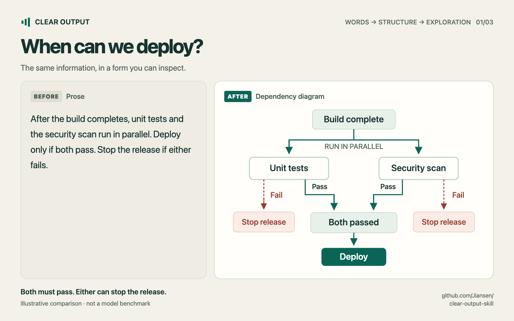
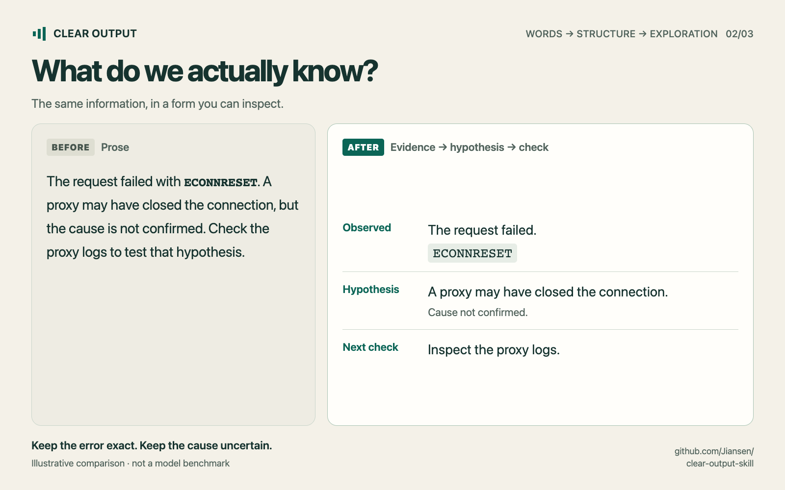
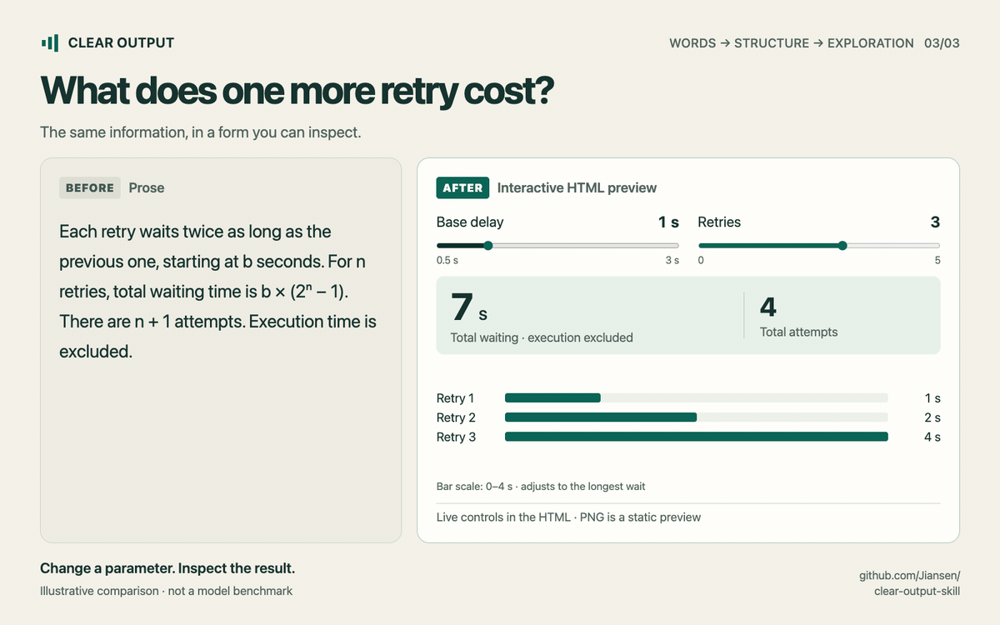

# Clear Output

[简体中文](README.zh-CN.md)

One skill for clearer Chinese, English, and mixed-language technical communication through words, diagrams, and interaction. It helps the reader understand and verify the result while preserving language, factual meaning, uncertainty, and technical literals.

Use it for debugging explanations, mechanisms, comparisons, status updates, instructions, and faithful rewrites. It is an instruction-only skill with no required runtime or background service. Producing visual artifacts uses whatever rendering tools the host provides; the skill does not depend on a specific plugin. The core evaluation helpers use Python's standard library; optional rendered-artifact checks use Node.js browser tooling.

## Before / after

The same release rule, shown as prose and a dependency diagram:



These are editorial examples of presentation, not measured model A/B results. [Browse the bilingual images and post drafts](assets/showcase/README.md), or see the [actual evaluation](evals/pilot-report.md).

<details>
<summary>Two more examples: debugging evidence and working interaction</summary>

Keep the observation, the unconfirmed cause, and the next check distinct:



Change a parameter and inspect the result. This animation uses screenshots of actual working HTML states; playback speed does not represent retry duration:



Download/open the [standalone preview](assets/showcase/showcase.html) to use the controls. GitHub's source view does not run HTML. [Static retry preview](assets/showcase/retry-en-landscape.png).

</details>

## What it does

- Chooses language from the user's request and the artifact being edited. An English debugging conversation stays English. A Chinese question about an English log gets a Chinese explanation with the log intact.
- Preserves facts, conditions, exceptions, approximate values, permissions, and recommendations. `May` does not become `will`; `约 5 秒` does not become an exact delay.
- Separates observed behavior from hypotheses and verified outcomes.
- Chooses the representation before polishing the wording: a table for shared criteria, a diagram for branches and dependencies, a chart for measured patterns, interaction for exploring variables, or animation/video for a mechanism that develops over time.
- Proactively creates a useful visual within the task's scope, checks the rendered result when possible, and distinguishes source/storyboards from working artifacts. A short factual answer can stay one sentence.

The skill applies to the current task. It does not turn the whole conversation into a permanent language or style mode. It does not check whether source facts are true, and it does not certify ASD-STE100 compliance.

## Install and use

The same `SKILL.md` and `references/` work in **Codex, Claude Code, and Cursor**. The optional `agents/openai.yaml` supplies Codex display metadata; the instructions require no host-specific tools. The terminal examples below use Bash on macOS/Linux and require Git.

| Host | Personal installation directory | Project-only directory | Invoke |
| --- | --- | --- | --- |
| Codex | `~/.agents/skills/clear-output/` | `.agents/skills/clear-output/` | `$clear-output` |
| Claude Code | `~/.claude/skills/clear-output/` | `.claude/skills/clear-output/` | `/clear-output` |
| Cursor | `~/.cursor/skills/clear-output/` | `.cursor/skills/clear-output/` | Type `/` in Agent chat and select `clear-output` |

Choose the section for your host. If it already lists `clear-output`, use that installation instead of adding another copy.

### Codex

Ask the built-in installer:

```text
$skill-installer install https://github.com/Jiansen/clear-output-skill
```

Or install manually:

```bash
mkdir -p ~/.agents/skills
git clone https://github.com/Jiansen/clear-output-skill.git ~/.agents/skills/clear-output
```

Host versions can use different skill directories; the built-in installer follows its host's configuration. See [Codex skill documentation](https://developers.openai.com/codex/skills).

### Claude Code

Install for your local Claude Code sessions:

```bash
mkdir -p ~/.claude/skills
git clone https://github.com/Jiansen/clear-output-skill.git ~/.claude/skills/clear-output
```

Then invoke `/clear-output` in Claude Code. If it is missing, run `/reload-skills` or start a new session. See [Claude Code skills](https://code.claude.com/docs/en/skills).

### Cursor

Install for your local Cursor Agent:

```bash
mkdir -p ~/.cursor/skills
git clone https://github.com/Jiansen/clear-output-skill.git ~/.cursor/skills/clear-output
```

Open a new Agent chat, type `/`, and select `clear-output`; restart Cursor if the new skill is not discovered. Cursor also reads `.agents/skills/`, `.claude/skills/`, and `.codex/skills/` and their user-level equivalents, so an existing Codex or Claude Code installation may already appear. Its **From GitHub Repository** UI installs marketplace plugins; this repository provides a standalone skill, so use the directory installation above. See [Cursor skills](https://cursor.com/docs/skills).

### Project-only and Windows installations

For one repository, copy `SKILL.md`, the complete `references/` directory, and `LICENSE` into the project-only directory in the table. Keep the folder name `clear-output`. Commit those files if teammates should receive the skill. Codex's `agents/openai.yaml` is optional.

In Windows PowerShell, for example:

```powershell
New-Item -ItemType Directory -Force "$HOME/.claude/skills" | Out-Null
git clone https://github.com/Jiansen/clear-output-skill.git "$HOME/.claude/skills/clear-output"
```

Replace `.claude` with `.cursor` for Cursor or `.agents` for Codex. Install in the environment where the agent runs; a local installation is not automatically a remote/cloud installation. For Cursor Cloud Agents, use the documented [personal-skill sync](https://cursor.com/help/customization/skills) or project skills.

### Claude on the web, Desktop chat, or Cowork

Use Claude's account-level skill upload. Local Claude Code folders do not by themselves install a skill into these surfaces.

From a checkout of this repository, create a ZIP containing only the skill resources and license:

```bash
git archive --format=zip --prefix=clear-output/ --output=../clear-output.zip HEAD SKILL.md references LICENSE
```

The archive contains `clear-output/SKILL.md`, `clear-output/references/`, and `clear-output/LICENSE`. In Claude, enable code execution/file creation if needed, then open **Customize → Skills → + → Create skill → Upload a skill**, upload the ZIP, and enable it. Ask Claude to use `clear-output` for your task. See [Claude's upload instructions](https://support.claude.com/en/articles/12512180-use-skills-in-claude) and [ZIP structure](https://support.claude.com/en/articles/12512198-how-to-create-custom-skills).

### Verify and update

Check that the installed `clear-output` folder contains `SKILL.md` and both files in `references/`. Try this in Claude Code or Cursor:

```text
/clear-output Explain this failing test in English. Keep the error text unchanged: expected 2 calls, received 3.
```

For Codex, use `$clear-output` instead of `/clear-output`. Chinese and mixed-language examples:

```text
$clear-output 帮我改清楚这段说明，保留原意、数值和不确定性。
```

```text
$clear-output 润色下面的英文 README，正文保持英文，用中文解释修改。
```

Use your host's invocation prefix in these examples. Expect English for the English debugging request and English README text with Chinese edit commentary for the mixed-language request. The description also permits automatic selection for matching tasks; triggering and available rendering tools depend on the host.

For a Git-based installation, update it with `git -C <installation-directory> pull --ff-only`, replacing the placeholder with the actual directory. If there are local edits, reconcile them before updating. For an uploaded Claude skill, rebuild the ZIP from the updated checkout and update the skill through Claude's UI.

Installation paths and invocation methods were checked against the linked official documentation on 2026-11-08. We verified the directory layouts and ZIP contents; automatic activation and output quality have not been tested in live Claude Code or Cursor sessions.

## A small example

Source:

> 建议先备份配置。等待约 5 秒后，可以重试；如果任务已取消，则不要重试。

A faithful revision:

> 建议先备份配置。如果任务已取消，不要重试。否则，等待约 5 秒后，可以重试。

The backup remains a recommendation, the delay remains approximate, and retry remains optional. Inventing a deadline or turning each sentence into an order would change the meaning.

## Test it

The first pilot contains 24 synthetic cases, a frozen semantic rubric, and three conditions: normal behavior, a short clarity prompt, and the full skill. See [the evaluation protocol](evals/README.md) and [the pilot report](evals/pilot-report.md) for actual outputs and limitations. A [follow-up evaluation](evals/form-report.md) compares the previous and expanded representation guidance and tests a real interactive artifact.

Try the self-contained [exponential-backoff explorer](examples/retry-backoff.html): change the delay and retry count to see individual waits and their total. Download/open the HTML locally; GitHub's source view does not run it.

```bash
python3 -m unittest discover -s tests -v
python3 tools/make_prompt.py full-skill > /tmp/clear-output-prompt.txt
python3 tools/check_responses.py evals/results/full-skill.json
```

The checker validates response coverage, selected literal preservation, and output contracts. **It cannot establish semantic equivalence or writing quality.** Semantic review is reported separately. The published pilot is a small development test, not evidence that a longer prompt generally improves a model.

## Project structure

| File | Purpose |
| --- | --- |
| [SKILL.md](SKILL.md) | Runtime instructions and activation description |
| [references/edge-cases.md](references/edge-cases.md) | Examples for difficult rewrites |
| [references/output-forms.md](references/output-forms.md) | Choosing and checking diagrams, charts, interaction, and media |
| [agents/openai.yaml](agents/openai.yaml) | Codex display metadata |
| [evals/](evals/) | Test inputs, criteria, raw responses, and review |
| [tools/](tools/) | Local evaluation helpers; not needed to use the skill |
| [examples/](examples/) | An actual generated and browser-tested explanation |
| [assets/showcase/](assets/showcase/) | Bilingual before/after graphics, working preview, post copy, and provenance |

## Origins and contributions

The project takes inspiration from [Andrej Karpathy's discussion of clearer AI output](https://x.com/karpathy/status/2105819303471976479), [ASD-STE100](https://www.asd-ste100.org/), and the open-source projects listed in [ATTRIBUTION.md](ATTRIBUTION.md). These are original bilingual instructions, not an official Chinese edition or a reproduction of the ASD dictionary.

Contributions should include a realistic failure case, the intended semantic invariants, and before/after responses. Prefer a narrow, demonstrated correction over adding universal rules. Keep evaluation inputs synthetic or explicitly licensed for publication.

MIT licensed. See [LICENSE](LICENSE).
