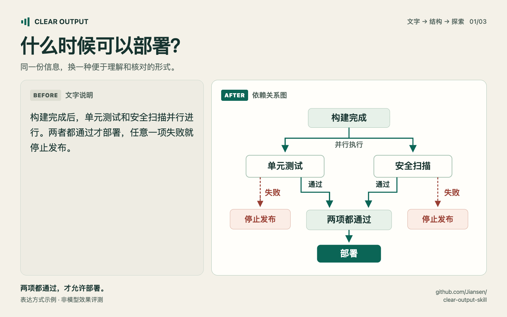
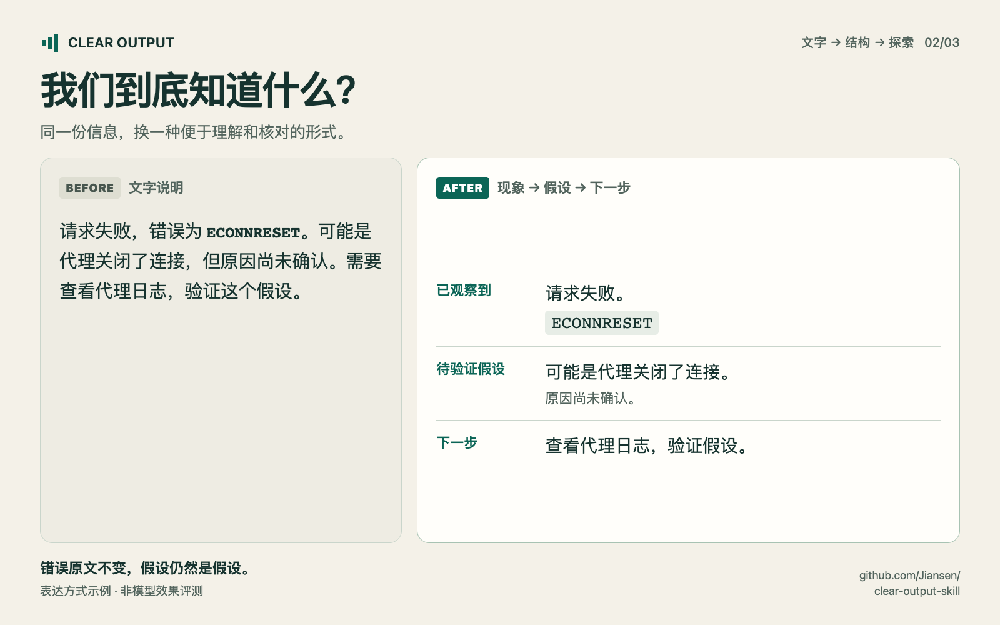
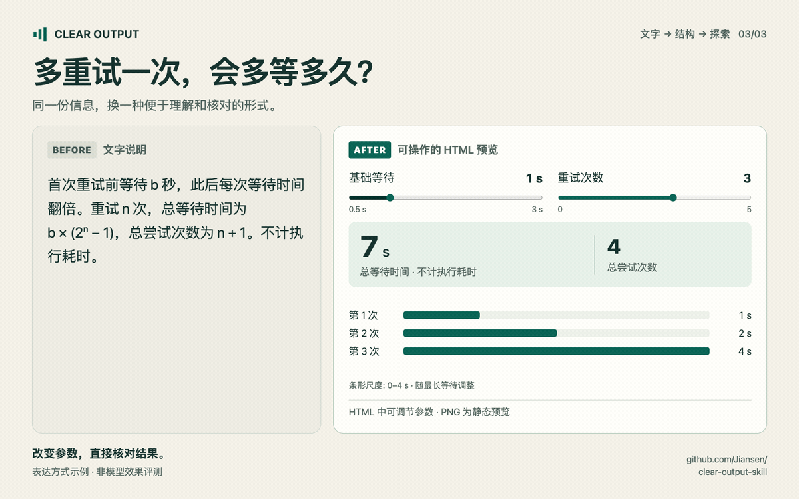

# Clear Output

[English](README.md)

[最新版本](https://github.com/Jiansen/clear-output-skill/releases/latest) · [更新日志](CHANGELOG.md) · [订阅更新通知](references/updates.md)

一个兼容中文、英文和中英混合内容的表达技能。通过文字、图示和交互，让读者更容易准确理解、核对结果，同时保留原意、语言、不确定性和技术原文。

适用于调试说明、机制讲解、方案比较、进展汇报、操作说明和忠实改写。核心提示词无需运行时或后台服务；可选的本地检查器使用 Python 3.10+，不需要额外安装包。生成图示或媒体时，使用宿主已有的工具，不绑定特定插件。

## Before / after：看看表达形式的变化

同一条发布规则，分别用文字和依赖图呈现：



这些是编排后的表达示例，并非模型前后效果实测。可以查看[完整中英文素材与发帖文案](assets/showcase/README.md)，或阅读[实际评测报告](evals/pilot-report.md)。

<details>
<summary>再看两组：调试证据与可操作的交互解释</summary>

把已观察到的错误、尚未确认的原因和下一步检查分开：



改变参数，直接核对结果。动图由实际运行的 HTML 页面状态截图组成；播放速度不代表重试时长：



下载并打开[独立 HTML 预览](assets/showcase/showcase.html)即可操作，顶部可切换中文。GitHub 源码页面不会运行 HTML。[静态交互预览图](assets/showcase/retry-zh-landscape.png)。

</details>

## 先选表达形式，再润色文字

| 读者需要理解什么 | 合适的起点 |
| --- | --- |
| 一个事实或一句说明 | 简短文字 |
| 多个方案在相同标准下的差异 | 表格 |
| 分支、依赖、参与者、消息顺序 | 流程图、依赖图、时序图 |
| 空间位置、外观或组件 | 标注图片、示意图 |
| 已有数值中的变化规律 | 带单位和尺度的图表 |
| 改变参数会发生什么 | 可操作的交互解释 |
| 随时间变化的过程 | 有助于理解的动画或讲解视频 |

遇到适合图示的问题，技能会主动采用它，不必再补一句“请画图”。形式的价值取决于它是否减少理解和核对的工作量；用户指定的纯文字、JSON 和文件格式优先。生成的图要保留条件、并行关系和不确定性，交互控件要真正影响结果。图源码、分镜稿和已渲染的视频，会如实区分。

## 语言怎么选

| 场景 | 输出 |
| --- | --- |
| 英文提问，讨论英文调试问题 | 英文回答 |
| 中文提问，附英文日志 | 中文解释，日志原样保留 |
| 中文要求润色英文 README | README 保持英文；修改说明可用中文 |
| 英文对话中要求中文 UI 文案 | 文案用中文；说明按用户要求 |
| 要求仅输出 JSON | 只返回指定 JSON |

明确的用户要求优先。代码、日志、引文和技能文件使用的语言，不会单独改变回复语言。规则作用于当前任务，不会把后续对话永久切换成中文或某种文风。

## 核心原则

- 清楚，但不捏造：不把“尽快”补成 10 分钟，不把“占用过高”补成 90%。
- 简洁，但不丢含义：保留“可能、建议、约”、条件、例外、操作顺序和同时发生的动作。
- 说明证据：代码改了、单元测试通过、生产问题已验证，是不同结论。
- 保护技术内容：命令、路径、日志、错误码和专业术语保持准确。
- 按理解任务选形式：需要追踪关系时画图，需要探索变量时提供交互；简短问题保持简短。

它不验证原始事实是否正确，也不宣称符合完整的 ASD-STE100 标准。

## 安装与使用

**Codex、Claude Code 和 Cursor 共用同一份 `SKILL.md` 与 `references/`。** `agents/openai.yaml` 仅提供 Codex 显示信息，技能正文不依赖特定宿主工具。下面的终端命令使用 macOS/Linux 的 Bash，需要已安装 Git。

| 宿主 | 个人安装目录 | 仅当前项目 | 调用方式 |
| --- | --- | --- | --- |
| Codex | `~/.agents/skills/clear-output/` | `.agents/skills/clear-output/` | `$clear-output` |
| Claude Code | `~/.claude/skills/clear-output/` | `.claude/skills/clear-output/` | `/clear-output` |
| Cursor | `~/.cursor/skills/clear-output/` | `.cursor/skills/clear-output/` | 在 Agent 聊天中输入 `/`，选择 `clear-output` |

按使用的宿主选择一种安装方式。如果技能列表中已经有 `clear-output`，先使用已有安装，避免重复。

### Codex

使用内置安装器：

```text
$skill-installer install https://github.com/Jiansen/clear-output-skill
```

也可以手动安装：

```bash
mkdir -p ~/.agents/skills
git clone https://github.com/Jiansen/clear-output-skill.git ~/.agents/skills/clear-output
```

不同宿主版本的技能目录可能不同，内置安装器遵循当前配置。参见 [Codex 官方文档](https://developers.openai.com/codex/skills)。

### Claude Code

安装到本机 Claude Code 的个人技能目录：

```bash
mkdir -p ~/.claude/skills
git clone https://github.com/Jiansen/clear-output-skill.git ~/.claude/skills/clear-output
```

在 Claude Code 中输入 `/clear-output`。如果没有出现，运行 `/reload-skills` 或开启新会话。参见 [Claude Code 官方文档](https://code.claude.com/docs/en/skills)。

### Cursor

安装到本机 Cursor Agent 的个人技能目录：

```bash
mkdir -p ~/.cursor/skills
git clone https://github.com/Jiansen/clear-output-skill.git ~/.cursor/skills/clear-output
```

打开新的 Agent 聊天，输入 `/` 并选择 `clear-output`；未发现新技能时重启 Cursor。Cursor 还会读取 `.agents/skills/`、`.claude/skills/`、`.codex/skills/` 及对应的个人目录，已有 Codex 或 Claude Code 安装可能已经可用。其 **From GitHub Repository** 界面用于 marketplace 插件；本仓库提供独立技能，请使用上述目录安装方式。参见 [Cursor 官方文档](https://cursor.com/docs/skills)。

### 仅当前项目与 Windows

如果只想在一个项目使用，将[正式版 ZIP](https://github.com/Jiansen/clear-output-skill/releases/latest/download/clear-output.zip)解压到表格中的项目目录，文件夹名保持 `clear-output`。保留完整包，包括 `references/`、`scripts/` 和 `VERSION`。需要团队共享时，把这些文件提交到项目仓库。Codex 的 `agents/openai.yaml` 是可选显示信息。

Windows PowerShell 示例：

```powershell
New-Item -ItemType Directory -Force "$HOME/.claude/skills" | Out-Null
git clone https://github.com/Jiansen/clear-output-skill.git "$HOME/.claude/skills/clear-output"
```

Cursor 将 `.claude` 改为 `.cursor`；Codex 改为 `.agents`。技能应安装在代理实际运行的环境，本机目录不会自动成为远程或云端安装。Cursor Cloud Agents 可使用官方的[个人技能同步](https://cursor.com/help/customization/skills)或项目技能。

### Claude 网页版、桌面聊天与 Cowork

这些场景使用 Claude 账号的技能上传入口；本机 Claude Code 文件夹本身不会把技能安装到这些场景。

直接下载可上传的[正式版 ZIP](https://github.com/Jiansen/clear-output-skill/releases/latest/download/clear-output.zip)，或在本仓库的 Git 工作目录中运行：

```bash
python3 tools/build_release.py --output-dir dist
```

命令生成 `dist/clear-output.zip` 和 `dist/SHA256SUMS`。ZIP 只有一个顶层 `clear-output/` 目录，包含提示词、参考资料、可选脚本、版本信息、更新日志和许可证。在 Claude 中按需启用代码执行／文件创建，然后进入 **Customize → Skills → + → Create skill → Upload a skill**，上传 ZIP 并启用。在对话中要求使用 `clear-output` 即可。参见官方[上传说明](https://support.claude.com/en/articles/12512180-use-skills-in-claude)和[打包结构](https://support.claude.com/en/articles/12512198-how-to-create-custom-skills)。

### 验证与更新

确认安装目录中有 `SKILL.md`、`VERSION`，以及完整的 `references/` 和 `scripts/` 目录。在 Claude Code 或 Cursor 中试用：

```text
/clear-output Explain this failing test in English. Keep the error text unchanged: expected 2 calls, received 3.
```

Codex 将 `/clear-output` 换成 `$clear-output`。中文与混合语言示例：

```text
$clear-output 把这段操作说明改清楚，保持原意。
```

```text
$clear-output 润色这段英文 README，正文保持英文，用中文解释修改。
```

在各宿主中使用对应的调用前缀。英文调试请求应得到英文回答；混合语言示例中的 README 应保持英文，修改说明用中文。宿主也可以按描述自动选择技能，具体触发和渲染能力取决于宿主。

在仓库中选择 **Watch → Custom → Releases**，订阅正式发布通知。每次发布提供更新说明、技能 ZIP 和校验和。在安装目录中运行：

```bash
python3 scripts/clear_output.py --version
python3 scripts/check_update.py
```

前者查看本地版本；后者主动请求 GitHub 的公开发布信息，只检查、不升级，也不上传文档。本地 skill 文件不会自行下载 GitHub 新版。Git 克隆并跟踪分支的安装，可在处理本地修改后用 `git -C <安装目录> pull --ff-only` 更新；它会跟随该分支，可能包含尚未正式发布的改动。下载／复制版和 Claude 上传版需更新完整发布包。固定 tag、备份和宿主重新加载的说明见[升级指南](references/updates.md)，改动内容见[更新日志](CHANGELOG.md)。

安装目录和调用方式于 2026-11-08 对照上述官方文档核实，已检查目录结构和 ZIP 内容；尚未在真实 Claude Code／Cursor 会话中验证自动触发和输出效果。

## 可选的本地检查器

用于较长的忠实改写、明确的输出约束或项目术语检查。按目标文档选择语言，不由引用的日志决定：

```bash
python3 scripts/clear_output.py answer.md --lang en
python3 scripts/clear_output.py answer.md --lang zh --source original.md --contract contract.json
python3 scripts/clear_output.py answer.md --lang mixed --glossary references/glossary.example.json
```

检查器验证指定原文与 JSON 格式，对数值、单位和语气标记变化给出复核提示，也可使用项目词表。英文单词与中文字符分别统计；需要时才启用句长建议。它输出具体问题和未检查范围，不给“清晰度／合规分数”，不自动修改文件。示例词表需要显式传入，不会默认生效。详见[输入格式、退出码、示例和边界](references/checks.md)。

## 我们怎么测试

仓库提供 24 个合成用例，覆盖中英切换、改写忠实度、英文日志、JSON、权限与能力、数值范围、模糊指代和证据范围。对比三组真实模型输出：普通回答、简短清晰表达提示、完整技能。

见[测试方法](evals/README.md)和[首轮实测报告](evals/pilot-report.md)。新增的[表达形式实测](evals/form-report.md)比较修订前后的输出选择，并验证真实交互产物。所有评估保留原始输出和逐项评审，允许发现技能没有提升甚至退步。

可以下载并打开[指数退避交互示例](examples/retry-backoff.html)，改变等待基数和重试次数，观察每次等待和总等待时间。文件独立运行，不发送网络请求；GitHub 源码页面不会直接执行它。

```bash
python3 -m unittest discover -s tests -v
python3 tools/make_prompt.py full-skill > /tmp/clear-output-prompt.txt
python3 tools/check_responses.py evals/results/full-skill.json
```

`tools/check_responses.py` 用于已有评测的完整性、部分技术原文和格式约束；`scripts/clear_output.py` 是新文档可用的可选检查器。测试还覆盖中英文、受保护内容、已知盲区、更新检查失败和独立 ZIP 安装。两种检查器都不能证明语义等价或阅读更轻松。已有模型评测早于这次程序检查器，不能作为新增检查器提升理解效果的证据。

## 来源与开源

受 [Karpathy 关于 AI 表达的分享](https://x.com/karpathy/status/2105819303471976479)、[ASD-STE100](https://www.asd-ste100.org/)及相关开源项目启发，参见[来源说明](ATTRIBUTION.md)。本项目是原创的双语技能，不是 ASD 官方中文版，没有复制其受控词典。

欢迎提交真实失败案例、需要保持的语义条件，以及改动前后的输出。先证明问题，再增加规则。公开测试请使用合成内容或已获发布许可的内容。

采用 [MIT 许可证](LICENSE)。
