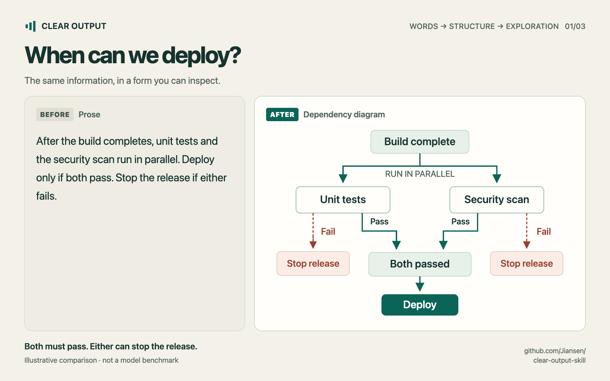
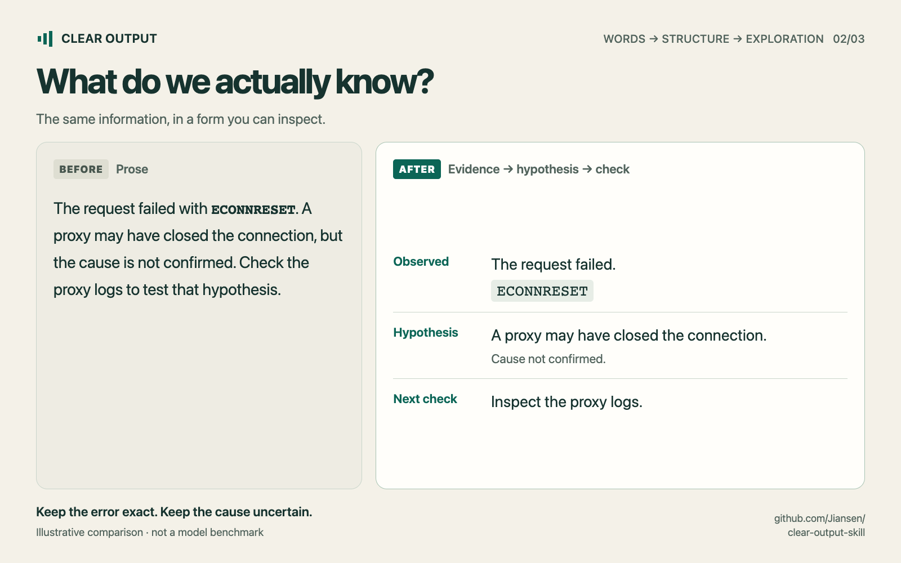
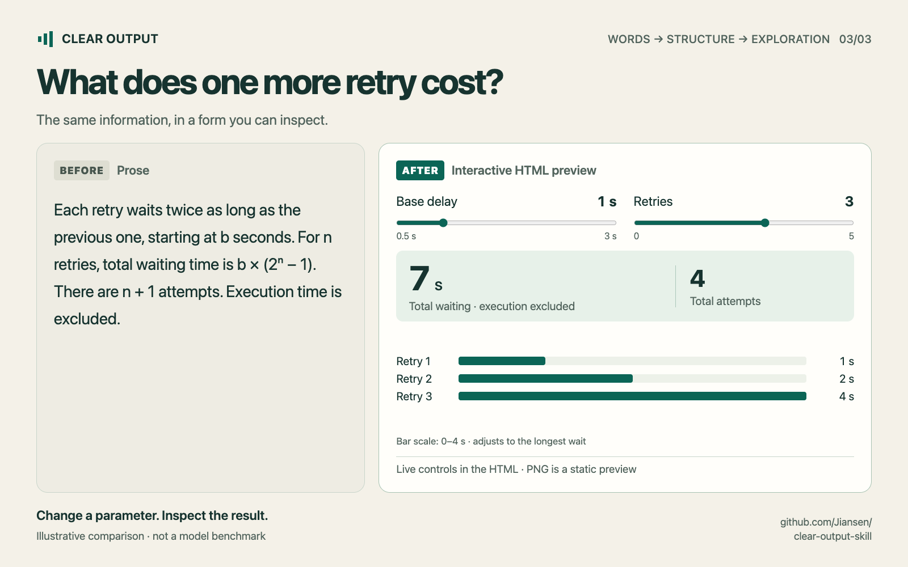

# Clear Output — visual examples

Three editorial before/after examples, in Chinese and English. Each starts with a readable, complete explanation and changes its presentation. These are **illustrative compositions**, not raw model transcripts, an A/B test, or evidence of a measured advantage from the skill.

[Ready-to-use post copy](posts.md) · [Editable, working HTML preview](showcase.html) · [Actual model evaluation](../../evals/pilot-report.md) · [Representation evaluation](../../evals/form-report.md)

Download/open `showcase.html` locally, or open it from a clone. Its language, example, and layout selectors work offline; the retry sliders change the calculated result. GitHub's source view does not run HTML. No external fonts, services, or JavaScript packages are needed to use this preview.

## The three examples

### 01 · When can we deploy?



The source is the release rule used in the project conversation. The diagram preserves parallel execution, the requirement that both checks pass, and either failure stopping the release. The two “Stop release” boxes show the same terminal outcome from either branch. It does not specify whether a running check is cancelled after the other fails.

### 02 · What do we actually know?



This is an authored, synthetic debugging example. The source already contains the observation, hypothesis, and next check; the after view groups them without claiming the cause is confirmed. The English example stays English, and `ECONNRESET` stays exact in both language versions.

### 03 · What does one more retry cost?



The preview implements the same mathematical model as the existing [retry explorer](../../examples/retry-backoff.html): retry `k` waits `b × 2^(k−1)` seconds, all `n` selected retries are counted, total wait is `b × (2^n − 1)`, and total attempts are `n + 1`. Execution time is excluded. These are local calculations, not real network requests or a production retry policy. The adjustable range is 0.5–3 seconds and 0–5 retries; the bar scale is labeled and adjusts with the maximum wait.

[Watch the English animation](retry-en.gif) · [查看中文动图](retry-zh.gif)

The GIFs assemble actual rendered page states changed through keyboard input. Each 10-second loop shows `(base delay, retries)` of `(1, 3)`, `(2, 3)`, `(2, 4)`, `(2, 0)`, then `(1, 3)`. These produce 7, 14, 30, 0, and 7 seconds of waiting. Playback duration does not represent retry timing. The PNGs are static previews; the HTML is interactive.

## Downloadable assets

The landscape layout is 1600 × 1000; the portrait layout is 1080 × 1350. These are project export sizes, not claims about any platform's required dimensions. Both GIFs are 1200 × 750. Use portrait images as a three-card sequence or share a single example.

| Example | English landscape | 中文横图 | English portrait | 中文竖图 |
| --- | --- | --- | --- | --- |
| Release | [PNG](release-en-landscape.png) | [PNG](release-zh-landscape.png) | [PNG](release-en-portrait.png) | [PNG](release-zh-portrait.png) |
| Debugging | [PNG](debugging-en-landscape.png) | [PNG](debugging-zh-landscape.png) | [PNG](debugging-en-portrait.png) | [PNG](debugging-zh-portrait.png) |
| Retry | [PNG](retry-en-landscape.png) | [PNG](retry-zh-landscape.png) | [PNG](retry-en-portrait.png) | [PNG](retry-zh-portrait.png) |

Use the post copy and accompanying alt text in [posts.md](posts.md). Keep the illustrative-example label when reusing or cropping the artwork. Captions are drafts for publication; creating these files does not publish a social-media post.

## Rebuild and check

The editable source is [showcase.html](showcase.html). It contains the bilingual copy, styles, dependency diagram, and working retry controls. From the repository root, with Node.js, Chrome, and FFmpeg installed:

```bash
npm ci --prefix evals/browser --ignore-scripts
node evals/browser/render-showcase.mjs
```

Set `CLEAR_OUTPUT_BROWSER` to a Chromium executable if needed. The script renders all 12 PNGs and two GIFs, checks layout bounds, and tests all 36 parameter combinations in each language against an independent closed-form calculation. It also checks the maximum-row portrait layout, keyboard and mouse input, preview selectors, mobile horizontal fit, JavaScript errors, and attempted HTTP(S) requests.

See [render-checks.json](render-checks.json) for the latest local run. These checks verify rendering and calculations. They do not measure human comprehension or model quality. Rebuilding can change font metrics across operating systems; inspect the resulting images before sharing. The ordinary CI workflow does not run Chrome or FFmpeg.

The assets are original project material under the repository's [MIT license](../../LICENSE).
