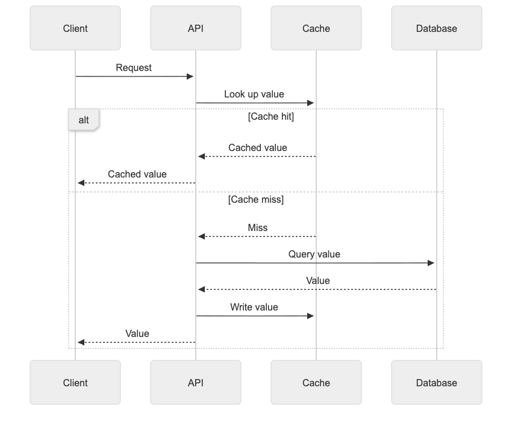

# Representation and artifact evaluation — 2026-11-08

This evaluation records the skill at commit `724ee51e0a62e56134d1ae43bf36e62d2b6de5da`. Later installation documentation and discovery metadata may differ; the recorded responses and hashes are unchanged.

**The expanded guidance makes representation choice and artifact verification explicit. This small comparison did not show a quality gain over the previous skill: both versions passed all 10 cases.** The previous version already chose useful diagrams under this host's general instructions.

The change follows the full [Karpathy post](https://x.com/karpathy/status/2105819303471976479), supplied by the user during review. Its motivation is human understanding and oversight as models do more work. It encourages diagrams/images, interactive HTML, and custom explainer videos, including artifacts made for a single question. See [source notes](../ATTRIBUTION.md) for the distinction between that motivation and this project's implementation choices.

## What changed

The previous skill had one sentence about choosing an output form. The new version asks the agent to identify what the reader must understand or verify, choose a representation before polishing prose, proactively produce a useful visual within the task, preserve meaning in the visual encoding, and verify the actual deliverable when tools permit.

Text remains suitable for short answers and explicit text-only requests. Tables, diagrams, images, charts, interaction, and animation/video have different jobs. A custom artifact need not become a reusable product to justify its creation.

## Paired source-level comparison

Two independent subject agents received the same [10 conversations](form-cases.json), one with the previous skill and one with the expanded skill. Neither saw the [rubric](form-rubric.json). A separate model reviewer saw shuffled answers without condition labels.

| Condition | Cases passing every invariant | Invariants passing | Forms rated effective |
| --- | --- | --- | --- |
| Previous skill | 10/10 | 26/26 | 10/10 |
| Expanded skill | 10/10 | 26/26 | 10/10 |

Both generated diagrams for request branches, concurrent prerequisites, measured latency, and component data flow. Both respected the two-sentence prose request, kept missing measurements unknown, followed the switch to English, distinguished hypotheses from observations, and supplied a storyboard without claiming a video existed in the explicitly text-only environment.

These results establish no measured advantage for the longer guidance. There was one sample per case in one batch per condition; both inherited the same host instructions, which already encourage useful visuals. The model reviewer is not a human comprehension study.

The original answers are preserved in [previous.json](forms/previous.json) and [current.json](forms/current.json). See [review.json](forms/review.json), [review-map.json](forms/review-map.json), [summary.json](forms/summary.json), and [the manifest](forms/manifest.json). The previous skill is preserved in [pre-forms-skill.txt](snapshots/pre-forms-skill.txt).

## Rendered diagrams

The parent agent rendered all **8 Mermaid outputs** in Chrome with Mermaid 12.3.0. All rendered without JavaScript errors. The four expanded-skill diagrams were also visually inspected for legibility, branch labels, and structure.

The first renderer configuration used a neutral theme that made the latency line too pale against white. This was a harness presentation issue, not a changed data value or a model answer failure. The renderer's chart palette was changed to a darker green and the diagrams were rendered again. Raw answers stayed unchanged. The [before image](forms/figures/latency-before-theme-fix.png), [final chart](forms/figures/current-f07-1.png), and [render results](forms/render-results.json) preserve that distinction.

Example: the generated sequence diagram exposes both cache paths and keeps the API responsible for database access.



## A working interactive explanation

A third subject received [a request for an exponential-backoff explorer](interactive-case.txt) and produced [one self-contained HTML file](../examples/retry-backoff.html). The request explicitly asked for a working HTML artifact; this tests delivery and correctness, not whether the skill independently decides to use HTML.

The parent then opened the actual file in Chrome and tested:

- All **36** allowed base-delay/retry-count combinations through keyboard input, checking the visible total, attempt count, individual waits, and cumulative waits against an independent closed-form calculation.
- The zero-retry state, reset, tab navigation, and a mouse change that updated the result.
- No horizontal overflow at a 390-pixel viewport; desktop default, desktop maximum, and mobile screenshots were visually inspected.
- No JavaScript errors and no attempted HTTP(S) requests during the test.

The default gives 7 seconds of waiting and 4 attempts; zero retries gives 0 seconds and 1 attempt; the maximum gives 93 seconds and 6 attempts. Execution time is explicitly excluded. The bars rescale to the longest wait in each setting, and the current scale is labeled.

See [browser results](forms/interactive-results.json), [desktop preview](../examples/retry-backoff-preview.png), and [mobile preview](forms/figures/retry-backoff-mobile.png). This is a functional explanation, not a production application or an accessibility certification.

## Reproduce the artifact checks

The skill itself needs none of these dependencies. For the optional local checks, use Node.js 22.12+ and installed Google Chrome:

```bash
npm ci --prefix evals/browser --ignore-scripts
node evals/browser/render-diagrams.mjs . evals/local/diagrams
node evals/browser/check-interactive.mjs examples/retry-backoff.html evals/local/interactive
```

Set `CLEAR_OUTPUT_BROWSER` to a compatible Chromium executable if Chrome is not installed in its standard location. The optional dependencies are pinned in the package lock. The ordinary GitHub workflow checks the Python helpers and response bundles; browser checks were run locally in the recorded environment.

The next useful test is whether readers answer questions more accurately or faster with these forms, using fresh tasks and multiple samples. Actual video rendering, narration, automatic skill selection, and interaction with other active skills remain untested.
